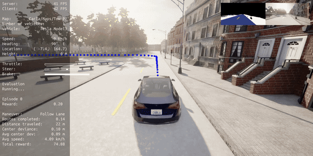
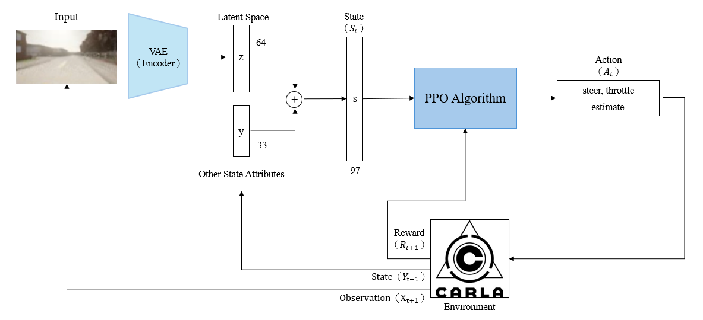
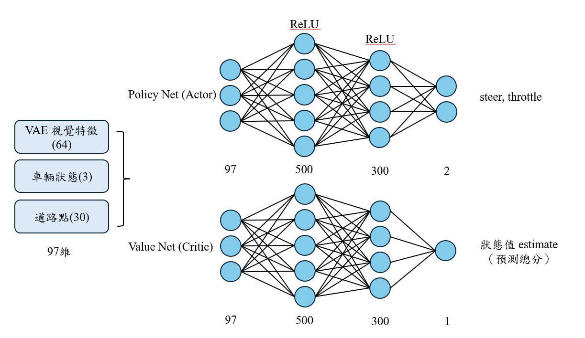
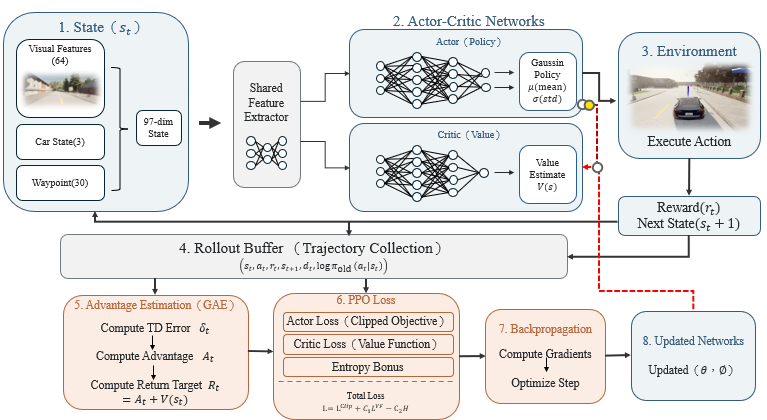
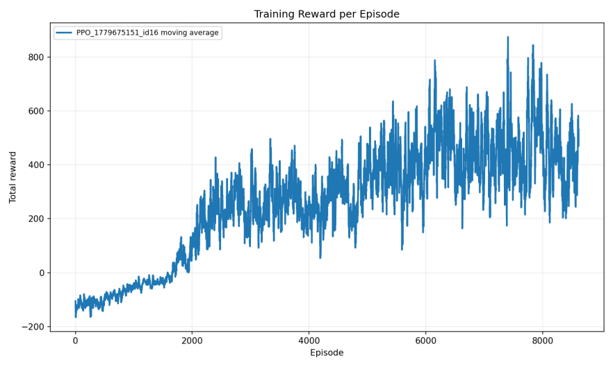
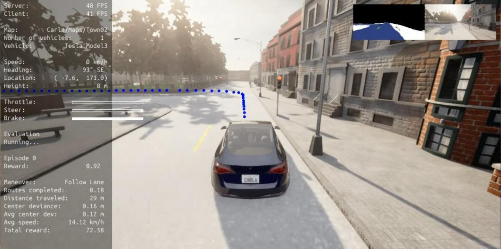

# 強化學習在自駕車系統之應用：PPO 決策模組

淡江大學人工智慧學系 114 學年度專題（指導老師：王銀添 教授）。本 repo 是專題中的 **強化學習決策模組**（負責人：陳廷祐），以 CARLA 模擬器搭配 Stable-Baselines3 的 PPO，訓練能車道置中、控制車速並在紅燈前停車的自駕車代理人。

完整專題報告：[docs/專題報告_強化學習在自駕車系統之應用.pdf](docs/專題報告_強化學習在自駕車系統之應用.pdf)（PPO 相關內容在第參章 3.1–3.6 節）。

<p align="center">
  
  <br>
  <em>v10 評估片段：依 CARLA 號誌狀態於路口停等。完整影片：<a href="docs/videos/ppo_v10_eval_demo.mp4">ppo_v10_eval_demo.mp4</a></em>
</p>

## 我負責的部分

在 [Maté 的 CARLA-SB3 訓練環境](https://github.com/alberto-mate/CARLA-SB3-RL-Training-Environment) 上做了以下修改：

- **複合型乘法獎勵**：速度 × 車道置中 × 車身角度 × 歷史偏移穩定度，空間因子下限縮放至 0.5，避免單一因素讓總分歸零、模型停滯不前。
- **方向盤平滑**：對動作輸出做指數平滑（`action_smoothing`），減少轉向震盪。
- **煞車動作與油煞互斥**：動作空間由 `[steer, throttle]` 擴充為 `[steer, throttle, brake]`，並且油門與煞車只保留較大者。
- **紅燈情境訓練**：讀取 CARLA 號誌狀態，訓練時以 30% 機率把遇到的號誌強制設為紅燈（持續 4–8 秒），並加入闖紅燈判定與紅燈專用的速度獎勵。

## 系統架構

<p align="center">
  
  <br><em>ADC-DRL 資訊流程：VAE 影像特徵與其他狀態合併成 97 維狀態，交給 PPO 輸出控制動作</em>
</p>

每個時間步的狀態 $s_t$ 由三部分組成，共 97 維：

| 來源 | 維度 | 內容 |
| --- | --- | --- |
| VAE 視覺特徵 | 64 | 前視相機影像經 VAE Encoder 壓縮的潛在向量 |
| 車輛狀態 | 3 | steer、throttle、speed |
| 導航路徑 | 30 | 前方 waypoints |

Actor 與 Critic 共用特徵抽取器，各自接兩層全連接（500 → 300，ReLU）。Actor 輸出高斯分佈的均值 $\mu$ 與可訓練的標準差 $\sigma$，抽樣出連續控制動作；Critic 輸出狀態價值 $V(s_t)$。

<p align="center">
  
  <br><em>Actor-Critic 網路</em>
</p>

### PPO 更新流程

<p align="center">
  
</p>

1. 與 CARLA 互動，把 $(s_t, a_t, r_{t+1}, s_{t+1})$ 存進 Rollout Buffer，直到碰撞、違規或達到最大步數。
2. 以 GAE 計算優勢值：$\delta_t = r_{t+1} + \gamma V(s_{t+1}) - V(s_t)$，$\hat{A}_t = \sum_l (\gamma\lambda)^l \delta_{t+l}$。
3. 最小化總損失 $L = -L^{CLIP} + c_1 L^{VF} - c_2 H$，其中 clip $\epsilon = 0.2$、$c_1 = 0.5$。
4. Adam 反向傳播並做梯度裁剪；PPO 為 on-policy，更新後清空 buffer 再進入下一輪。

## 獎勵設計

基礎獎勵為四個因子相乘，值域 $[0, 1]$：

$$\text{Reward} = \text{Speed} \times \text{Centering} \times \text{Angle} \times \text{DistanceStd}$$

| 因子 | 計算方式 |
| --- | --- |
| Speed | $V \le V_{min}$：$V / V_{min}$；$V_{min} < V \le V_{target}$：1.0；$V > V_{target}$：線性遞減至 $V_{max}$ |
| Centering | $\max(1 - D / D_{max}, 0)$，$D_{max} = 3.0$ m |
| Angle | $\max(1 - \lvert\theta / \theta_{max}\rvert, 0)$，$\theta_{max} = 90^\circ$ |
| DistanceStd | 過去 30 步車道偏移標準差 $\sigma$：$\max(1 - \sigma / 0.4, 0)$ |

**紅燈情境**：依車輛與號誌距離 $D_t$ 設定目標速度 $V_{stop} = \max(0, D_t - 5)$。若 $V \le V_{stop} + 2$ 則速度獎勵為 1.0，否則為 $\max(0, 1 - (V - V_{stop}) / 10)$。另外非紅燈長時間停滯會給怠速懲罰。

**終止條件**：碰撞、偏離車道超過 $D_{max}$、超速，或紅燈時以高於 2 km/h 的速度通過停止線（闖紅燈）。

相關程式：

- 獎勵函數：[`carla_env/rewards.py`](carla_env/rewards.py)
- 紅燈偵測、強制紅燈、油煞互斥：[`carla_env/envs/carla_route_env.py`](carla_env/envs/carla_route_env.py)
- 狀態編碼（含 `red_light`）：[`carla_env/state_commons.py`](carla_env/state_commons.py)
- 實驗設定：[`config.py`](config.py) 的 `_CONFIG_16`

## 訓練設定（config 16）

| 參數 | 值 |
| --- | --- |
| learning rate | 3e-5 → 1e-6 排程 |
| gamma / gae_lambda | 0.98 / 0.95 |
| clip_range / ent_coef | 0.2 / 0.005 |
| n_steps / batch_size / n_epochs | 1024 / 128 / 5 |
| net_arch | pi: [500, 300]、vf: [500, 300] |
| VAE | `vae_64` |
| action_smoothing | 0.75 |
| 訓練步數 | 5,000,000 |

## 實驗結果

<p align="center">
  
  <br><em>紅燈訓練版本的每回合總獎勵（移動平均）</em>
</p>

<p align="center">
  
  <br><em>紅燈前煞停：速度 0 km/h，油門、方向盤歸零，煞車作動</em>
</p>

repo 內保留兩組 500 萬步的實驗，每組都有 `config.json`、`progress.csv`、TensorBoard events、模型與評估 CSV／圖：

| 資料夾 | 說明 | 評估結果 |
| --- | --- | --- |
| [`tensorboard/PPO_1776260506_id1`](tensorboard/PPO_1776260506_id1) | 一般 PPO（車道保持＋速度控制） | 4/4 回合成功，平均車速 18.39 km/h，平均車道偏移 0.033 m |
| [`tensorboard/PPO_1785232694_id16`](tensorboard/PPO_1785232694_id16) | PPO＋煞車＋紅燈訓練 | 搭配 v10 控制流程：`final_v10`、`controller_v10_acceptance_8x4500` 各 8/8 成功 |

說明：

- 報告第 3.5 節的數據（平均車速 22.85 km/h、行駛 681.53 m、平均每步獎勵 0.8959）來自另一次測試紀錄，無法與這裡的 CSV 一一對應。
- id16 的 8/8 成功包含外部控制流程的作用，不能全部歸因於 PPO；同一模型不加 v10 控制時的原始評估（`model_5000000_steps_eval*`）20 回合皆未成功，一併保留作比較。
- 紅燈停車使用的是 CARLA 直接提供的號誌狀態，尚未接攝影機號誌辨識；換路口、換交通條件後的表現仍待測試。

## 安裝與使用

報告中使用的環境：CARLA 0.9.16、Stable-Baselines3 2.9.0、CUDA 13.0；硬體為 Ryzen 9 7900X3D、RTX 4090 × 2、128 GB RAM。`requirements.txt` 沿用原框架的版本清單，請依自己的 CARLA 版本調整 `carla` 套件。

```bash
python3 -m venv venv
source venv/bin/activate
pip install -r requirements.txt
export CARLA_ROOT=<CARLA 安裝路徑>
```

訓練、檢視與評估：

```bash
python train.py --config 16 --total_timesteps 5000000
tensorboard --logdir tensorboard
python eval.py --config 16 --model tensorboard/PPO_1785232694_id16/model_5000000_steps.zip
```

評估路線可在 `carla_env/envs/carla_route_env.py` 的 `eval_routes` 修改。VAE 訓練與資料收集請見 `vae/train_vae.py`、`carla_env/envs/collect_data_*.py`。

## 專題分工

| 成員 | 模組 |
| --- | --- |
| 陳廷祐 | 強化學習決策模組（PPO、獎勵設計、煞車與紅燈訓練）← 本 repo |
| 莊正綸 | VAE 視覺資訊壓縮、LaneNet 車道分割 |
| 徐子洋 | 純視覺 AEB 自動緊急煞車系統、雙系統整合 |

## 致謝與引用

本專案的訓練環境建立在 Alberto Maté 的 [CARLA-SB3-RL-Training-Environment](https://github.com/alberto-mate/CARLA-SB3-RL-Training-Environment) 之上，架構參考 Razak 的 ADC-DRL。若使用原框架，請引用：

```
@software{Mate_CARLA-SB3-RL-Training-Environment_out-of-the-box_training_2023,
  author = {Mate, Alberto},
  month = jun,
  title = {{CARLA-SB3-RL-Training-Environment: out-of-the-box training and evaluation environment for DRL in CARLA simulator}},
  url = {https://github.com/alberto-mate/CARLA-SB3-RL-Training-Environment},
  version = {1.0.0},
  year = {2023}
}
```
